# Анализ ресурсов базы данных Front

## 1. Анализ закупки продукции

### Выводы

- Закупки в базе ведутся с ноября 2020 по декабрь 2023 года: 22 016 строк на
  20 018 690,28 руб. (130 625,826 единиц).
- Пик закупок — 2021 год: 9 450 109,62 руб. (47,2 % всей суммы).
- Средняя цена закупки выросла со 117,08 руб. в 2020 году до 174,35 руб. в 2023 году.
- Топ-3 закупаемой продукции: сыр «Голландский, моцарелла» (4 046 169,91 руб.),
  лосось (2 969 574,88 руб.), ветчина (1 091 550,66 руб.).
- Поставщик № 211 «Пятая Армия» занимает 49,1 % закупок; топ-10 поставщиков —
  92,8 % закупок. Концентрация закупок высокая.

### Основные таблицы

#### `bm_StorageOperations`

Строки складских операций: приход, списание, количество, цена и сумма.

| Колонка | Назначение | Пример данных |
|---|---|---|
| `ID` | ключ строки | `6326063` |
| `DocumentID` | шапка документа | `465980` |
| `OperationID` | тип операции | `1` |
| `ProductID` | товар | `4377` |
| `VendorID` | поставщик | `91` |
| `StorageID` | склад | `41` |
| `RangeID` | единица измерения | `42` |
| `Count` | количество в единицах хранения | `6.0000` |
| `Price` | цена | `404.00` |
| `Amount` | сумма строки | `2424.00` |
| `DateAdd` | дата и время операции | `2023-12-04 17:08:07` |
| `Quantity` | служебное поле; в данных равно 0, для расчётов используется Count | `0.0000` |

#### `bm_StorageOperationsType`

Справочник типов складских операций.

| Колонка | Назначение | Пример данных |
|---|---|---|
| `ID` | тип операции | `1` |
| `Description` | название | `Поступление` |
| `Factor` | знак операции (+1/-1) | `1` |
| `DateAdd` | дата создания | `2013-01-15 15:19:12` |

#### `product`

Справочник товаров и ингредиентов.

| Колонка | Назначение | Пример данных |
|---|---|---|
| `id` | внутренний код товара | `4337` |
| `productid` | внешний код/штрихкод | `1204073` |
| `description` | наименование | `Бананы` |
| `CategoryID` | категория | `200` |
| `SizeID` | единица измерения | `42` |
| `vendorid` | поставщик (в данных почти не заполнен) | `107` |
| `cost` | себестоимость | `0.00` |
| `price1…price4` | уровни цен (в данных NULL) | `NULL` |
| `onhand` | остаток (в данных NULL) | `NULL` |
| `IsUse` | признак использования | `1` |

#### `vendors`

Справочник поставщиков.

| Колонка | Назначение | Пример данных |
|---|---|---|
| `id` | код поставщика | `211` |
| `clientid` | внешний код | `Пятая Армия` |
| `firstname` | название/имя | `Пятая Армия` |
| `lastname` | фамилия (для ИП/физлиц) | `NULL` |
| `clientgroup` | группа поставщика | `32` |
| `INN` | ИНН | `NULL` |
| `teln` | телефон | `NULL` |
| `emaliaddress` | email | `NULL` |
| `contactperson` | контактное лицо | `NULL` |
| `IsUse` | активность | `1` |

#### `storages`

Справочник складов. В базе один склад — `id = 41`.

| Колонка | Назначение | Пример данных |
|---|---|---|
| `id` | склад | `41` |
| `CompanyID` | организация | `6` |
| `description` | название | `Склад` |
| `ResponsibleID` | ответственный | `897` |
| `DepartmentID` | подразделение | `0` |

### Связанные таблицы

#### `bm_Companies`

Организации. В базе одна организация — ИП «Пиzzбург».

| Колонка | Назначение | Пример данных |
|---|---|---|
| `ID` | организация | `6` |
| `CompanyName` | полное название | `ИП Лукьянова Анастасия Игоревна` |
| `ShortName` | краткое название | `Пиzzбург` |
| `INN` | ИНН | `380122679974` |
| `KPP` | КПП | `NULL` |
| `OGRN` | ОГРН | `320385000078976` |

#### `category`

Категории товаров.

| Колонка | Назначение | Пример данных |
|---|---|---|
| `id` | категория | `200` |
| `description` | название | `Овощи фрукты` |
| `ParentID` | родительская категория | `199` |
| `StorageID` | склад по умолчанию | `41` |
| `IsUse` | признак использования | `1` |

#### `pricelist`

История цен/закупочных цен по товарам.

| Колонка | Назначение | Пример данных |
|---|---|---|
| `id` | строка прайса | `113681` |
| `DocumentID` | документ установки цен | `142417` |
| `productid` | товар | `4544` |
| `vendorid` | поставщик (в данных NULL/0) | `NULL` |
| `groupid` | ценовая группа | `2` |
| `basecost` | базовая закупочная цена | `140.00` |
| `netcost` | цена нетто | `NULL` |
| `dateeff` | дата начала действия | `NULL` |

#### `size`

Единицы измерения/размеры.

| Колонка | Назначение | Пример данных |
|---|---|---|
| `ID` | единица | `42` |
| `sizeid` | код | `кг` |
| `description` | название | `кг` |
| `portionsize` | базовая единица | `г` |
| `portionrate` | коэффициент | `1000.000` |

### ER-диаграмма (drawDB)

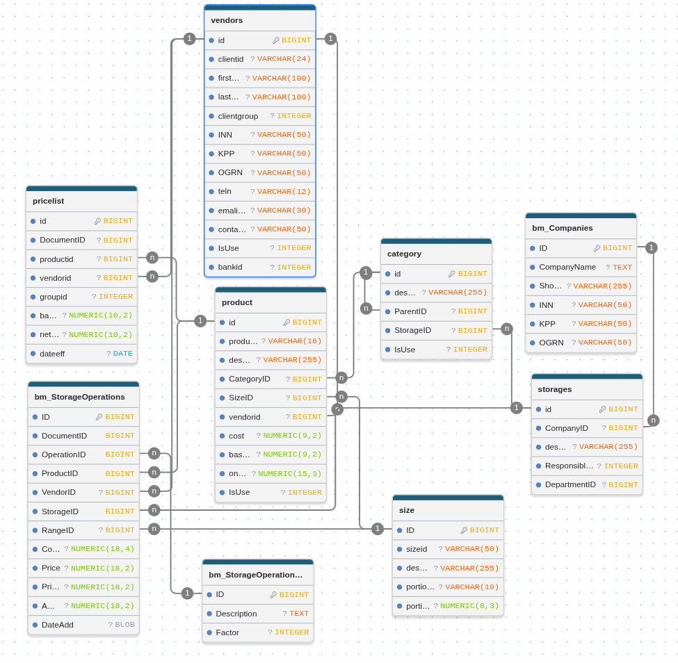

### SQL-запросы и результаты

#### Запрос 1.1. Закупки по годам

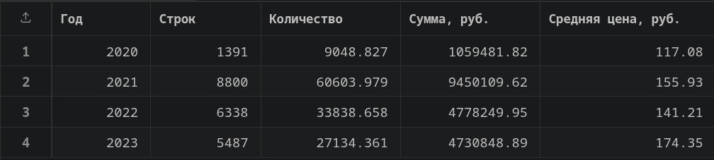

#### Запрос 1.2. Топ-10 закупаемой продукции

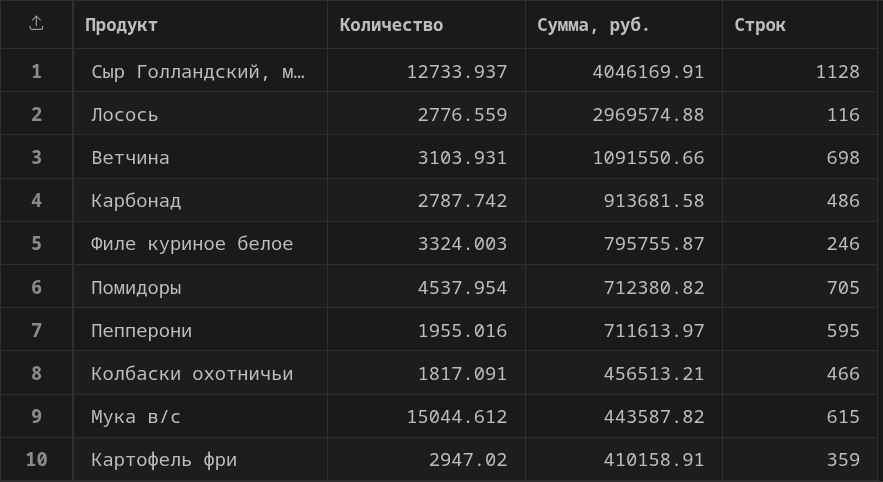

#### Запрос 1.3. Топ-10 поставщиков по закупкам

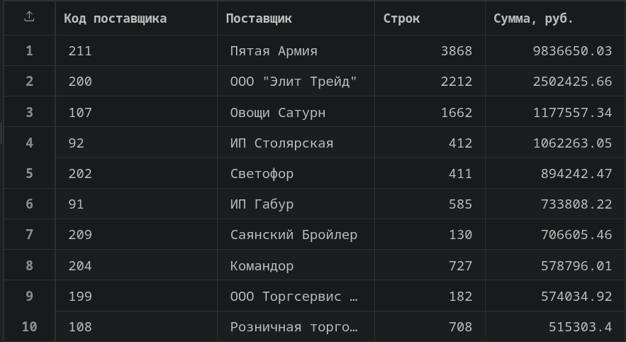

#### Запрос 1.4. Закупки по категориям

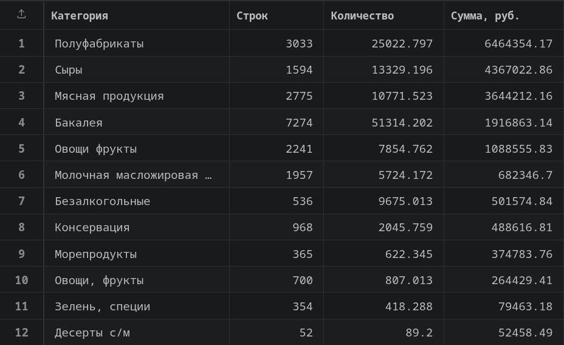

## 2. Анализ продажи товара

### Выводы

- Продажи за 2020–2023 годы: 43 043 чека, 119 367 строк, чистая выручка
  42 306 984,17 руб. Возвраты — 500 383,50 руб. (1,2 % от продаж).
- Средний чек вырос с 860,92 руб. в 2020 году до 1 035,68 руб. в 2023 году.
- Топ-товары: «Пицца К Пиву 50см» (2 286 198,50 руб.), «Пицца К пиву 40 см»
  (2 252 866,25 руб.), «Комбо 2 сочетание вкусов» (2 082 288,00 руб.).
- 99,94 % оплат в `journal` — наличные (42 275 294,67 руб.); Visa — только
  20 операций на 23 921,00 руб.
- Крупнейшие категории: «Мясные» (13 151 537,25 руб.), «Комбо наборы»
  (6 310 933,00 руб.), «50 см» (6 164 677,00 руб.).
- `bm_Journal_Details` содержит 1 089 641 строку и разлагает продажи на
  ингредиенты; это основной источник для расчёта себестоимости и расхода сырья.

### Основные таблицы

#### `journal`

Главный журнал операций: строки продаж, итоги чеков, оплаты и входы сотрудников.

| Колонка | Назначение | Пример данных |
|---|---|---|
| `transnumber` | номер строки журнала | `1951181` |
| `transtype` | тип операции | `101` |
| `dater` | дата и время | `2023-12-06 13:58:26` |
| `receiptn` | номер чека | `50672281` |
| `id` | внешний код товара (product.productid) | `7239833` |
| `description` | наименование товара | `Соус Барбекю` |
| `quantity` | количество | `1.000` |
| `price` | цена | `50.00` |
| `amount` | сумма | `50.00` |
| `discountamount` | сумма скидки | `0.00` |
| `flagrefund` | признак возврата | `0` |
| `loginid` | логин/код сотрудника | `906` |
| `customerid` | код клиента | `12345` |

#### `bm_Journal_Details`

Детализация продаж/списаний по ингредиентам.

| Колонка | Назначение | Пример данных |
|---|---|---|
| `ID` | строка детализации | `224362909` |
| `SourceID` | строка journal | `1707073` |
| `ProductID` | ингредиент | `7646` |
| `BludoID` | блюдо/полуфабрикат | `7202` |
| `Count` | количество ингредиента | `0.1907` |
| `Quantity` | количество порций | `1.0000` |
| `TicketNumber` | номер чека | `11617698` |
| `RangeID` | единица измерения | `42` |
| `SizeID` | размер | `163` |
| `StorageID` | склад | `41` |

#### `transtype`

Справочник типов транзакций.

| Колонка | Назначение | Пример данных |
|---|---|---|
| `transtypeid` | тип | `101` |
| `transgroupid` | группа типа | `1` |
| `description` | описание | `PLU Sales` |
| `PreviewGroupType` | группа предпросмотра | `POS` |

#### `product`

Справочник товаров.

| Колонка | Назначение | Пример данных |
|---|---|---|
| `id` | внутренний код | `4420` |
| `productid` | внешний код | `3591888` |
| `description` | наименование | `Пицца Рэд бинс 24 см` |
| `CategoryID` | категория | `152` |
| `SizeID` | размер | `1` |
| `cost` | себестоимость | `0.00` |

#### `category`

Категории меню.

| Колонка | Назначение | Пример данных |
|---|---|---|
| `id` | категория | `152` |
| `description` | название | `Мясные` |
| `ParentID` | родительская категория | `151` |
| `StorageID` | склад | `41` |
| `IsUse` | признак использования | `1` |

### Связанные таблицы

#### `size`

Единицы измерения/размеры.

| Колонка | Назначение | Пример данных |
|---|---|---|
| `ID` | единица | `1` |
| `sizeid` | код | `порция` |
| `description` | название | `порция` |
| `portionrate` | коэффициент | `1.000` |

#### `storages`

Склад, к которому относится продажа/списание.

| Колонка | Назначение | Пример данных |
|---|---|---|
| `id` | склад | `41` |
| `description` | название | `Склад` |
| `CompanyID` | организация | `6` |

### ER-диаграмма (drawDB)

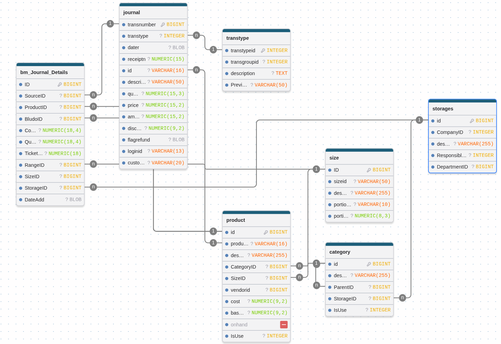

### SQL-запросы и результаты

#### Запрос 2.1. Выручка, возвраты и средний чек по годам

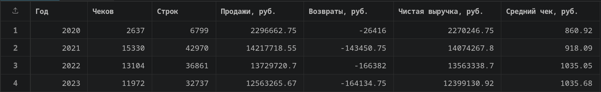

#### Запрос 2.2. Топ-10 товаров по выручке

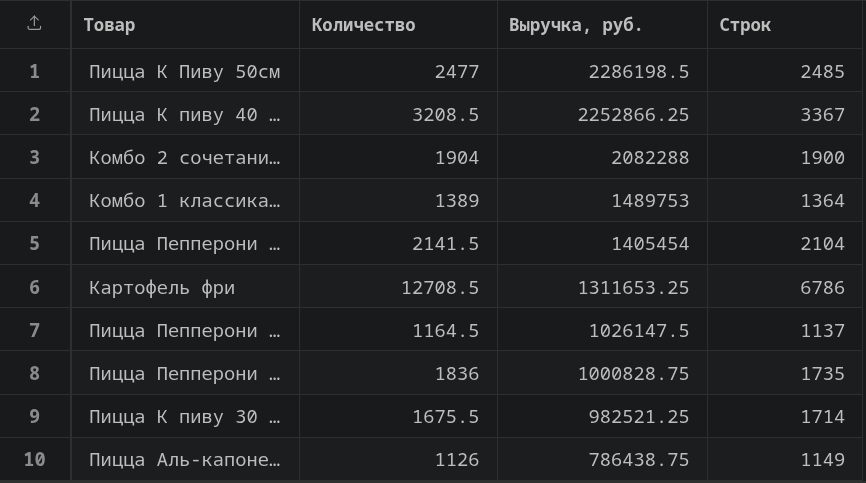

#### Запрос 2.3. Структура оплаты

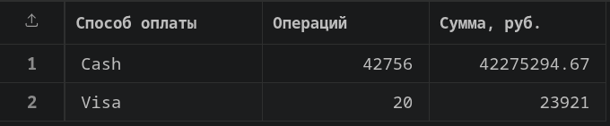

#### Запрос 2.4. Выручка по категориям

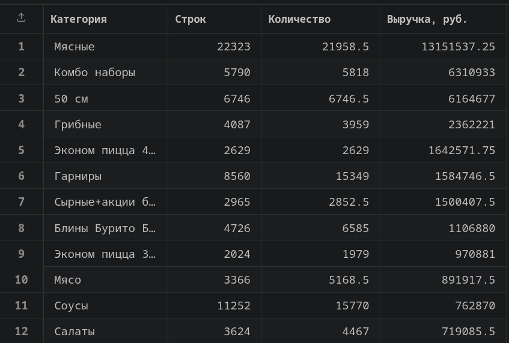

## 3. Анализ взаимоотношений с поставщиками

### Выводы

- В справочнике 63 поставщика, из них 20 активны (`IsUse = 1`).
- 59 поставщиков отнесены к группе «Поставщики», 4 — к группе «Без названия».
- Поставщик № 211 «Пятая Армия» — 49,1 % закупок; топ-10 — 92,8 %.
- Карточки поставщиков заполнены слабо: ИНН — у 5 из 63, телефон, email и
  контактное лицо — ни у одного.
- Связь `product.vendorid` заполнена только у 1 из 1 545 товаров;
  `bm_StorageOperations.VendorID` — у 11 358 из 22 016 строк (51,6 %).
  Это основной надёжный источник атрибуции закупок.
- Договоров (`bm_Contracts`) — 0; претензий (`complaince`) — 0.
  Договорная и претензионная работа в базе не ведётся.

### Основные таблицы

#### `vendors`

Справочник поставщиков: реквизиты, контакты, группа, активность.

| Колонка | Назначение | Пример данных |
|---|---|---|
| `id` | код поставщика | `211` |
| `clientid` | внешний код | `Пятая Армия` |
| `firstname` | название/имя | `Пятая Армия` |
| `lastname` | фамилия | `NULL` |
| `clientgroup` | группа (`vendorgroup`) | `32` |
| `INN` | ИНН | `NULL` |
| `KPP` | КПП | `NULL` |
| `OGRN` | ОГРН | `NULL` |
| `teln` | телефон | `NULL` |
| `emaliaddress` | email | `NULL` |
| `contactperson` | контактное лицо | `NULL` |
| `IsUse` | активность | `1` |

#### `vendorgroup`

Группы поставщиков.

| Колонка | Назначение | Пример данных |
|---|---|---|
| `vendorgroupid` | группа | `31` |
| `description` | название | `Поставщики` |
| `flag` | признак | `0` |

#### `bm_StorageOperations`

Закупочные строки: поставщик, товар и сумма.

| Колонка | Назначение | Пример данных |
|---|---|---|
| `ID` | строка | `6326063` |
| `VendorID` | поставщик | `91` |
| `ProductID` | товар | `4377` |
| `StorageID` | склад | `41` |
| `Count` | количество | `6.0000` |
| `Price` | цена | `404.00` |
| `Amount` | сумма | `2424.00` |
| `DateAdd` | дата | `2023-12-04 17:08:07` |

#### `product`

Товары.

| Колонка | Назначение | Пример данных |
|---|---|---|
| `id` | товар | `4337` |
| `productid` | внешний код | `1204073` |
| `description` | наименование | `Бананы` |
| `vendorid` | поставщик | `107` |
| `cost` | себестоимость | `0.00` |

#### `bm_Contracts`

Договоры с поставщиками. Таблица пуста (0 строк).

| Колонка | Назначение | Пример данных |
|---|---|---|
| `ID` | договор | `—` |
| `CompanyID` | организация | `—` |
| `VendorID` | поставщик | `—` |
| `ContractNumber` | номер | `—` |
| `Period` | срок | `—` |

### Связанные таблицы

#### `bm_Companies`

Организация, от имени которой ведутся закупки.

| Колонка | Назначение | Пример данных |
|---|---|---|
| `ID` | организация | `6` |
| `CompanyName` | полное название | `ИП Лукьянова Анастасия Игоревна` |
| `ShortName` | краткое название | `Пиzzбург` |
| `INN` | ИНН | `380122679974` |

#### `storages`

Склад, на который принимается закупка.

| Колонка | Назначение | Пример данных |
|---|---|---|
| `id` | склад | `41` |
| `description` | название | `Склад` |
| `CompanyID` | организация | `6` |

#### `complaince`

Претензии по организациям. Таблица пуста (0 строк).

| Колонка | Назначение | Пример данных |
|---|---|---|
| `id` | претензия | `—` |
| `CompanyID` | организация | `—` |
| `description` | описание | `—` |

### ER-диаграмма (drawDB)

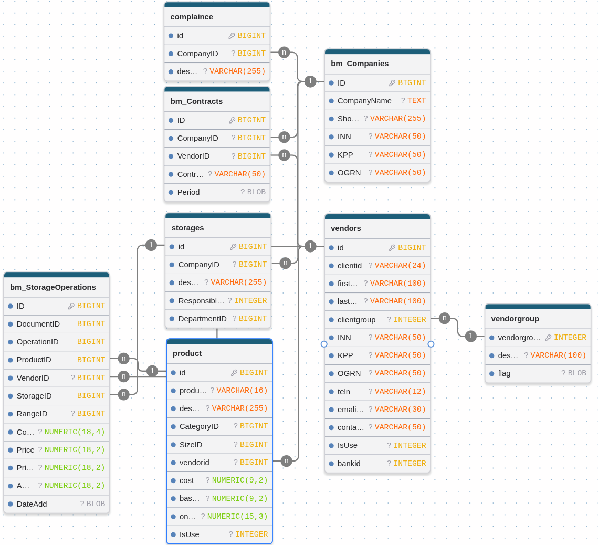

### SQL-запросы и результаты

#### Запрос 3.1. Поставщики по группам

#### Запрос 3.2. Топ-10 поставщиков: доля в закупках

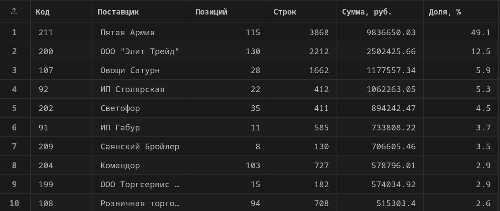

#### Запрос 3.3. Заполненность карточек поставщиков

#### Запрос 3.4. Заполненность связей «товар/закупка/договор — поставщик»

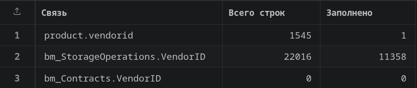

#### Запрос 3.5. Договоры и претензии

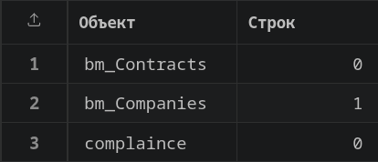

## 4. Анализ работы персонала

### Выводы

- В `personnel` 109 карточек. Уровни доступа: 1 — 102 сотрудника, 9 — 5,
  3 — 2. Доступ к POS (`flagpos = 1`) выставлен у 12 карточек.
- Операционная активность сосредоточена на служебных учётках:
  - 906 «Доставка» — 40 215 бонусных записей;
  - 897 «Администратор Barnet» — 156 923 сессии и 75 222 ошибки.
- В журнале сессий преобладают системные и служебные события; их типы,
  количество и число ошибок приведены в запросе 4.3.
- Бонусная история привязана к 21 сотруднику, но 89,6 % записей приходится
  на служебный профиль 906.
- `bm_WorkHours` пуста (0 строк), `bm_ShiftsOperations` содержит 1 строку,
  `personnelmessages` — 1 строку. Учёт рабочего времени и коммуникации в базе
  не ведутся.
- Кассовые операции (`bm_CashOperations`) пусты, справочник
  `bm_CashOperationsType` содержит 7 записей.

### Основные таблицы

#### `personnel`

Справочник сотрудников: ФИО, уровень доступа, флаги прав.

| Колонка | Назначение | Пример данных |
|---|---|---|
| `personid` | код сотрудника | `906` |
| `lastname` | фамилия | `Доставка` |
| `firstname` | имя | `Доставка` |
| `middlename` | отчество | `NULL` |
| `securityaccess` | уровень доступа | `3` |
| `flagpos` | доступ к POS | `1` |
| `flagsales` | доступ к продажам | `0` |
| `flagreports` | доступ к отчётам | `0` |
| `deleteflag` | признак удаления | `1` |
| `percent` | процент/ставка | `0.000` |

#### `bm_JournalSessions`

Сессии/журнал действий пользователей и системных событий.

| Колонка | Назначение | Пример данных |
|---|---|---|
| `ID` | событие | `174072` |
| `Type` | тип события | `barnetbc.ru` |
| `Message` | сообщение | `Ошибка при выполнении операции...` |
| `IsError` | признак ошибки | `1` |
| `DateAdd` | дата | `2023-12-06 14:18:08` |
| `UserAdd` | пользователь | `userdb` |
| `PersonID` | сотрудник | `897` |

#### `bm_BonusHistory`

История бонусных начислений/операций.

| Колонка | Назначение | Пример данных |
|---|---|---|
| `ID` | запись | `84860` |
| `ClientID` | клиент | `255` |
| `ActionName` | действие | `Journal` |
| `BonusValue` | значение бонуса | `13542789.74` |
| `Period` | период | `2023-12-06 10:31:54` |
| `TicketNumber` | чек | `59368651` |
| `PersonID` | сотрудник | `906` |
| `IsCalc` | признак расчёта | `1` |

#### `bm_ShiftsOperations`

Смены. В базе 1 запись.

| Колонка | Назначение | Пример данных |
|---|---|---|
| `ID` | смена | `65` |
| `ShiftNumber` | номер смены | `1` |
| `Amount` | сумма | `0.00` |
| `DateAdd` | дата | `2015-07-14 10:29:13` |
| `PersonalID` | сотрудник | `0` |
| `CompanyID` | организация | `6` |

#### `bm_WorkHours`

Учёт рабочего времени. Таблица пуста (0 строк).

| Колонка | Назначение | Пример данных |
|---|---|---|
| `ID` | запись | `—` |
| `ShiftID` | смена | `—` |
| `PersonID` | сотрудник | `—` |
| `DateR` | дата | `—` |
| `SystemPeriod` | системный период | `—` |
| `ManualPeriod` | ручной период | `—` |

### Связанные таблицы

#### `bm_ShiftsOperations_Values`

Дополнительные значения смен. Таблица пуста (0 строк).

| Колонка | Назначение | Пример данных |
|---|---|---|
| `ID` | значение | `—` |
| `ParentID` | смена | `—` |
| `Pattern` | шаблон | `—` |
| `Value` | значение | `—` |

#### `personnelmessages`

Внутренние сообщения сотрудников. В базе 1 запись.

| Колонка | Назначение | Пример данных |
|---|---|---|
| `id` | сообщение | `1` |
| `personfrom` | отправитель | `0` |
| `personto` | получатель | `1` |
| `messagetime` | время | `2008-03-25 15:44:02` |
| `message` | текст | `—` |

#### `bm_CashOperations`

Кассовые операции. Таблица пуста (0 строк).

| Колонка | Назначение | Пример данных |
|---|---|---|
| `ID` | операция | `—` |
| `ShiftID` | смена | `—` |
| `PersonID` | сотрудник | `—` |
| `Amount` | сумма | `—` |

#### `bm_CashOperationsType`

Типы кассовых операций. 7 записей.

| Колонка | Назначение | Пример данных |
|---|---|---|
| `ID` | тип | `1` |
| `Description` | описание | `Принято по смене` |
| `Factor` | знак | `1` |
| `IsUseDocument` | требует документ | `0` |

### ER-диаграмма (drawDB)

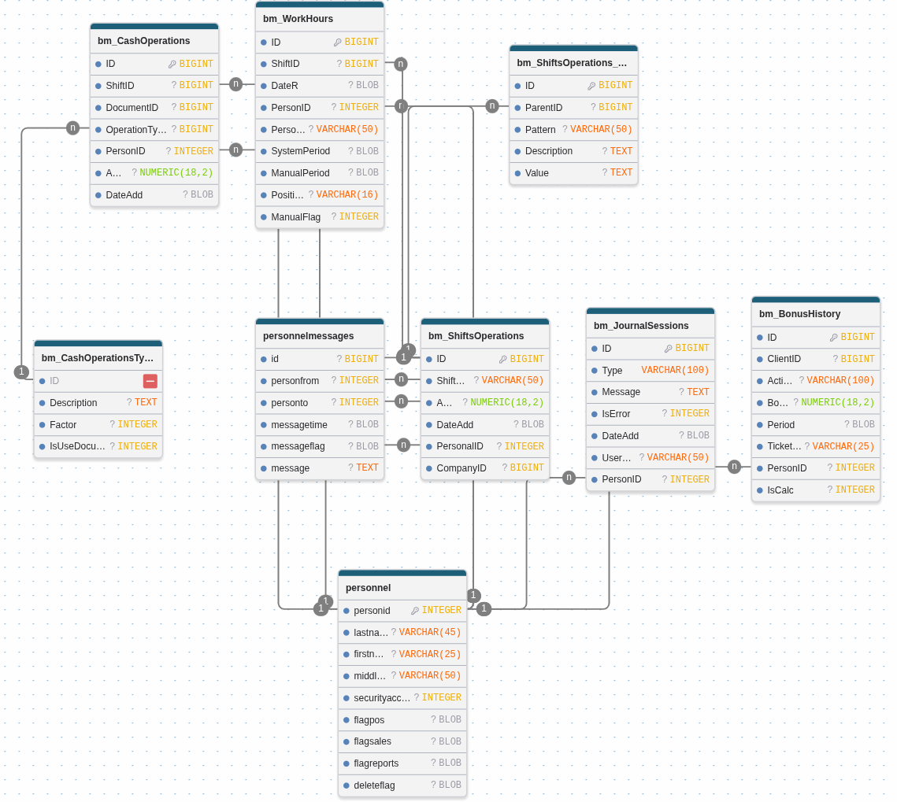

### SQL-запросы и результаты

#### Запрос 4.1. Структура персонала по уровням доступа

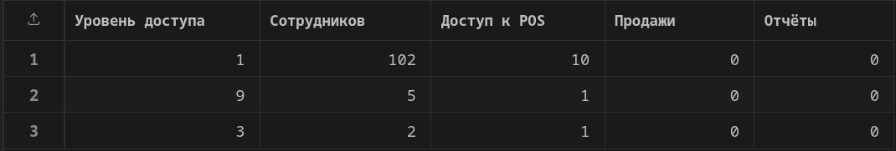

#### Запрос 4.2. Активность сотрудников в системе

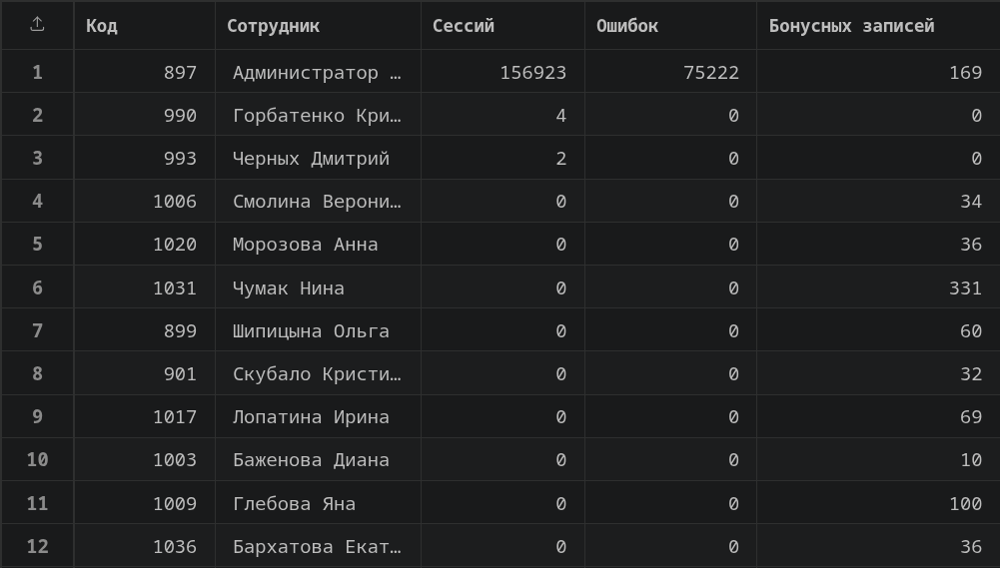

#### Запрос 4.3. Типы событий в журнале сессий

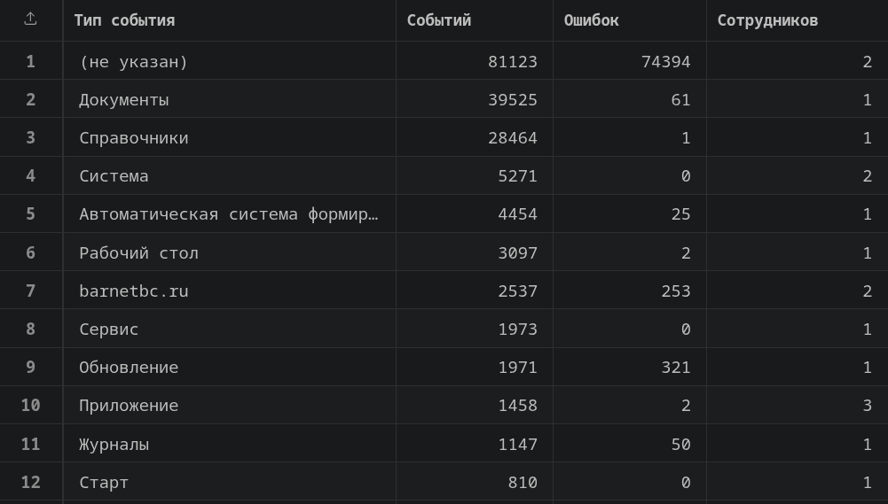

#### Запрос 4.4. Бонусные начисления по сотрудникам

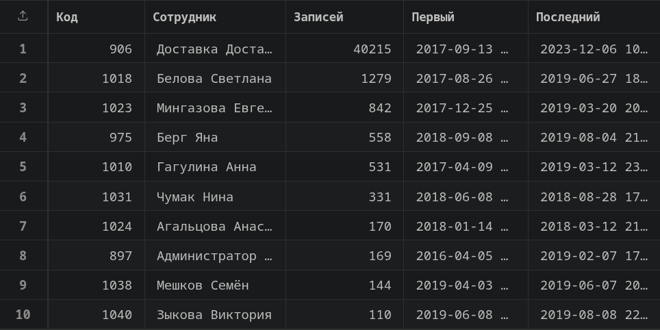

#### Запрос 4.5. Наличие данных по персоналу и сменам

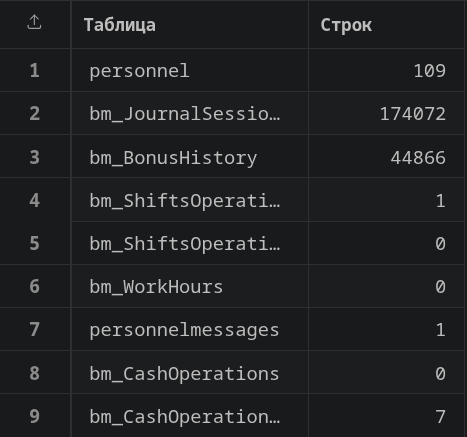

## 5. Анализ остатков

### Выводы

- В базе есть только два типа складских операций: «Поступление» (22 016 строк,
  +130 625,826 единиц) и «Списание» (1 009 182 строки, −728 963,845 единиц).
  Инвентаризация, перемещение и возврат не используются.
- Период движений — с 15.11.2020 по 04.12.2023.
- Наибольший оборот: сыр «Голландский, моцарелла» (20 515 719,00 руб.), ветчина
  (6 359 225,27 руб.), карбонад (6 199 958,88 руб.), мука итальянская
  (5 909 485,30 руб.), лосось (5 731 847,17 руб.).
- Текущий остаток в базе отсутствует: `product.onhand` — 0 заполненных,
  таблицы `stock` и `storagesonhand` пусты.
- Расчёт баланса только по движениям 2020–2023 даёт отрицательные значения
  (например, вода −79 575,757; мука в/с −62 982,535; сыр −55 359,435).
  Это подтверждает отсутствие входящих остатков.
- Вывод: по базе можно анализировать движение и расход, но нельзя достоверно
  рассчитать текущий остаток без инвентаризации/входящих остатков.

### Основные таблицы

#### `bm_StorageOperations`

Основные строки движений товара.

| Колонка | Назначение | Пример данных |
|---|---|---|
| `ID` | строка | `6326063` |
| `DocumentID` | документ | `465980` |
| `OperationID` | тип операции | `1` |
| `ProductID` | товар | `4377` |
| `StorageID` | склад | `41` |
| `RangeID` | единица | `42` |
| `Count` | количество (со знаком) | `6.0000` |
| `Price` | цена | `404.00` |
| `PriceCost` | себестоимость | `0.00` |
| `Amount` | сумма | `2424.00` |
| `DateAdd` | дата | `2023-12-04 17:08:07` |

#### `bm_StorageOperationsType`

Типы складских операций.

| Колонка | Назначение | Пример данных |
|---|---|---|
| `ID` | тип | `1` |
| `Description` | название | `Поступление` |
| `Factor` | знак (+1/-1) | `1` |

#### `product`

Товары.

| Колонка | Назначение | Пример данных |
|---|---|---|
| `id` | товар | `4337` |
| `productid` | внешний код | `1204073` |
| `description` | наименование | `Бананы` |
| `CategoryID` | категория | `200` |
| `SizeID` | единица | `42` |
| `onhand` | остаток | `NULL` |
| `cost` | себестоимость | `0.00` |

#### `storages`

Склад. В базе один склад — `id = 41`.

| Колонка | Назначение | Пример данных |
|---|---|---|
| `id` | склад | `41` |
| `description` | название | `Склад` |
| `CompanyID` | организация | `6` |
| `ResponsibleID` | ответственный | `897` |

#### `size`

Единицы измерения количества.

| Колонка | Назначение | Пример данных |
|---|---|---|
| `ID` | единица | `42` |
| `sizeid` | код | `кг` |
| `description` | название | `кг` |
| `portionrate` | коэффициент | `1000.000` |

#### `pricelist`

Цены товаров.

| Колонка | Назначение | Пример данных |
|---|---|---|
| `id` | строка | `113681` |
| `productid` | товар | `4544` |
| `basecost` | закупочная цена | `140.00` |
| `netcost` | цена нетто | `NULL` |

### Связанные таблицы

#### `stock`

Таблица остатков. Пуста (0 строк).

| Колонка | Назначение | Пример данных |
|---|---|---|
| `cspcid` | товар | `—` |
| `onhand` | остаток | `—` |
| `quantity` | количество | `—` |

#### `storagesonhand`

Остатки по складам. Пуста (0 строк).

| Колонка | Назначение | Пример данных |
|---|---|---|
| `ID` | запись | `—` |
| `productid` | товар | `—` |
| `storageid` | склад | `—` |
| `onhand` | остаток | `—` |

#### `category`

Категории товаров.

| Колонка | Назначение | Пример данных |
|---|---|---|
| `id` | категория | `200` |
| `description` | название | `Овощи фрукты` |
| `ParentID` | родительская категория | `199` |
| `StorageID` | склад по умолчанию | `41` |
| `IsUse` | признак использования | `1` |

### ER-диаграмма (drawDB)

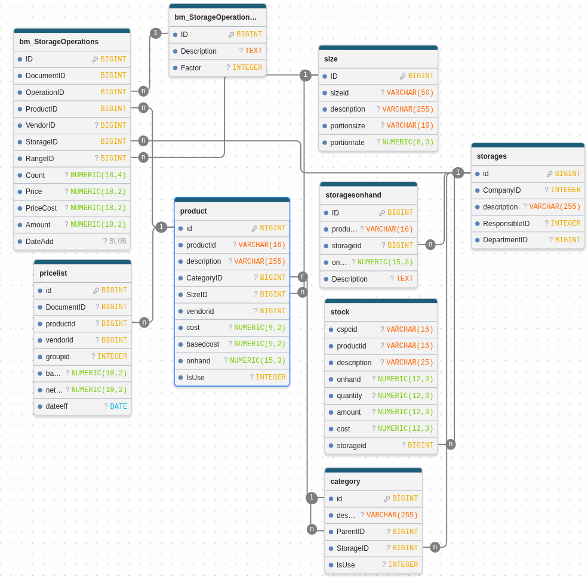

### SQL-запросы и результаты

#### Запрос 5.1. Движение товара по типам операций

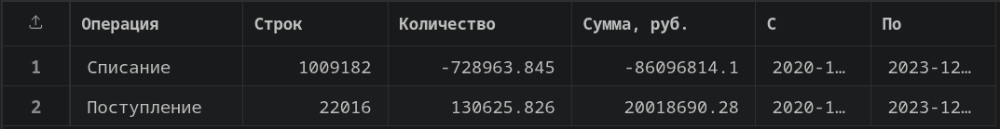

#### Запрос 5.2. Топ-10 товаров по складскому обороту

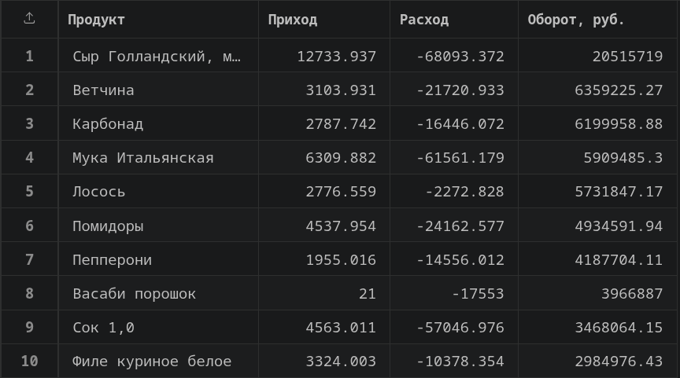

#### Запрос 5.3. Топ-10 списываемых ингредиентов

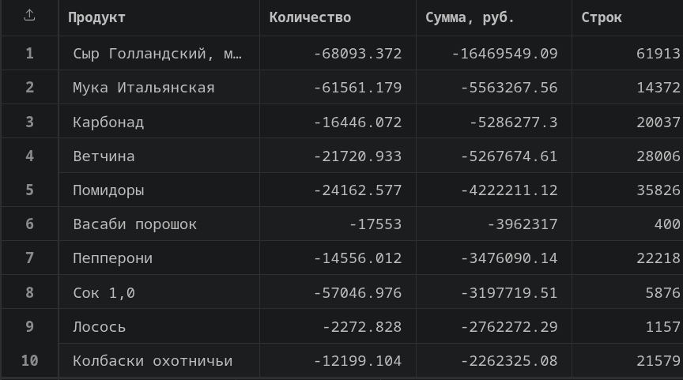

#### Запрос 5.4. Наличие данных об остатках

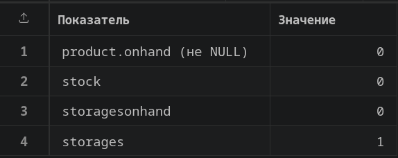

#### Запрос 5.5. Баланс только по движениям 2020–2023

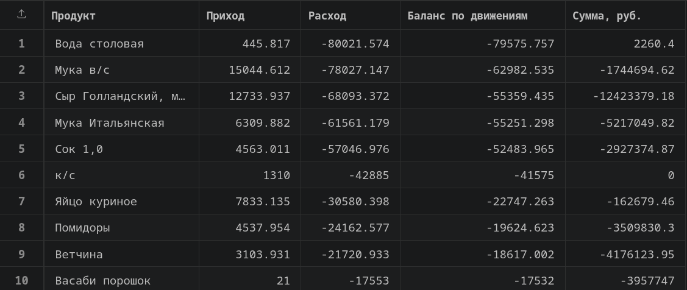