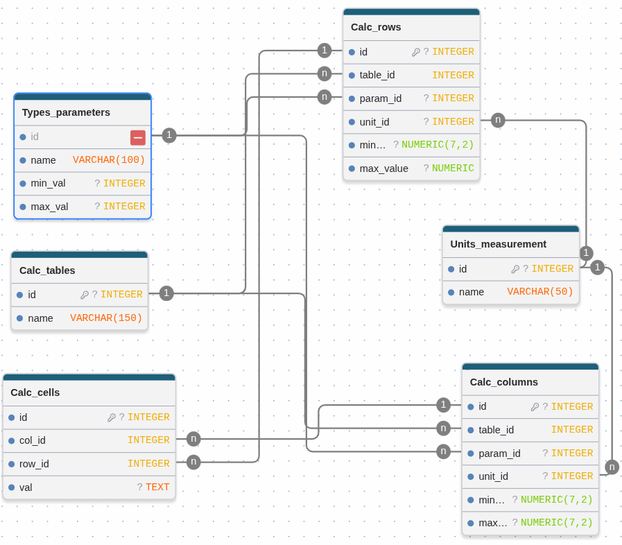

## Таблица calc_Tables
Таблица для связки отдельных колонок и строк в 1 единую таблицу

## Таблица calc_Columns
Таблица с столбцами, привязываются к calc_Tables по table_id. Param_id, unit_id параметер и единицы измерения значения столбца, min/max_val диапазон значения столбца

## Таблица calc_Rows
То же что и calc_Rows только строки

## Таблица calc_Cells
Пересечение столбцов и строк, связывается с ними по col_id и row_id соответственно, val значение в text, для хранения любого значения
